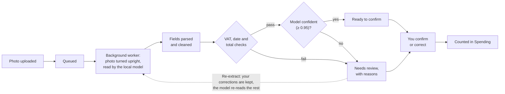

# Receipt Tracker

[](https://github.com/WMGamponia/ReceiptExtractor/actions/workflows/ci.yml)

Snap or upload a Philippine receipt, get a clean record, and see where your money went. **The app and its AI model run on your own computer, so your receipts never leave it.**


*The real app (Docker, `qwen3-vl:8b-instruct` on an AMD GPU) with a synthetic receipt: the model reads `08/09/2026` as September 8, the date is fixed in review ("You corrected"), and it shows up in August's spending.*

> **Status:** works end to end, from photo to reviewed receipt to spending summary, and ships as Docker, a Windows exe and a demo site. Still growing the test dataset and tuning the prompt; see the [roadmap](ROADMAP.md).
>
> _Last updated: 2026-11-24_

**Stack:** ASP.NET Core (.NET 10) · EF Core + SQLite · Ollama (`qwen3-vl:8b-instruct`) · xUnit · React + TypeScript PWA (Vite) · Python for the extraction eval

**Built with [Claude Code](https://claude.com/claude-code)** as a pair programmer; see [How it was built](#how-it-was-built).

## What this project shows

- **The approach was chosen by testing, not guessing.** Before building the app, I hand-labeled real receipts and compared OCR + LLM against a vision model on them: 19% vs 86% core accuracy ([bake-off](#extraction-bake-off)).
- **CI blocks merging if accuracy drops under 85%.** The model's outputs are committed, so CI scores them without a GPU, and it fails if the prompt, model or dataset changes without a re-run.
- **Privacy by design.** Everything runs locally; OCR text (with TINs) never goes into git; the public live demo registers no database or storage and keeps nothing.
- **Built for how models fail.** Extraction runs in a background queue with live status; a VAT checksum and date checks send suspicious receipts to review; corrections can be locked and the rest re-read.
- **One rule, three languages, one set of tests.** The VAT check exists in C#, TypeScript and Python, and all three run against the same cases in `tests/vat-cases.json`.
- **Shipped three ways:** `docker compose up` with sample data, a single-file Windows exe, and a static demo site that replays real model answers.

## Try it

### In your browser: the demo site

**https://receipt-tracker-demo.pages.dev**, nothing to install.

- **Every screen works**, filled with made-up receipts: review and correct them, confirm them, see the spending summary, export a CSV.
- **The sample receipts under Add** are made-up photos that the real model read on my PC. Picking one replays its actual answer, mistakes included, after the time it really took.

> [!IMPORTANT]
> **Reading your own receipt photos only works while my PC is running the live demo.** The demo site has no AI model of its own: your photo is sent to my PC, read there by the real model, and the answer comes back to your browser. Nothing is kept (no database, no storage; the photo is dropped once it's read), and it's limited to 20 photos an hour per visitor.
>
> The live demo is only on now and then, since it runs on my own GPU. The banner at the top of the site tells you which: "photos you add are sent to the author's PC" means it's on, "nothing leaves your browser" means it's off. When it's off, the samples and every other screen still work, and you can type a receipt's fields in by hand. To read your own receipts any time, run the app on your own PC (below). How the live demo works: [docs/live-demo.md](docs/live-demo.md#read-on-the-authors-pc-live-demo-on-demand).

### On your own PC

**With Docker** (needs [Docker Desktop](https://www.docker.com/products/docker-desktop/)), from a terminal:

```bash
git clone https://github.com/WMGamponia/ReceiptExtractor.git
cd ReceiptExtractor
docker compose up --build
```

After a few minutes' first build (~1 GB download), open **http://localhost:5080**: every screen, with 18 real receipts (personal details painted over) waiting for review and 40 made-up ones on the Spending page. Reading **your own** photos also needs the AI model, a 6 GB download that reads a receipt in ~10–20s on a supported GPU and takes minutes on a CPU. Step-by-step guides, including troubleshooting: [Windows](docs/install/windows.md) · [Linux](docs/install/linux.md), then [NVIDIA GPU](docs/install/nvidia-gpu.md) · [AMD GPU](docs/install/amd-gpu.md).

### Limitations

- **The AI model needs a capable GPU.** Receipts take ~10–20s each on a desktop GPU (tested on an AMD RX 9070 XT) and **minutes on a CPU**. Running the model on a cloud service would drop this requirement, but receipt photos would leave your machine; it's an idea for later, not built.
- **Built for Philippine receipts:** peso amounts, 12% VAT included in the total, BIR-style receipts. JPG and PNG photos only (no PDFs or HEIC).
- **The model makes mistakes:** 87% of dates, merchants and totals are right on the 18 labeled receipts (a small sample; see [Known issues](#known-issues)). That's why every receipt goes through a review screen, and suspicious ones are flagged.
- **One user, no logins.** Anyone who can reach port 5080 sees every receipt, so don't expose it to the internet.
- **Installing it as a phone app needs HTTPS**, which the local app doesn't have. Opening it in the phone's browser on the same Wi-Fi works.

## What it does

- **Add:** take a photo (opens the back camera on a phone) or drop/pick files. The model reads each one in the background.
- **Receipts:** everything waiting for review, with status updating live while the model reads. Tick receipts (or **Select all ready to confirm**) and confirm them in one go; anything that failed a check is called out before you confirm.
- **Review:** the photo next to the extracted fields. VAT math is re-checked as you type, and future dates are flagged (the model sometimes swaps day and month). The photo can be rotated, zoomed and dragged; **←.** / **.→** move a misplaced decimal point (`112446.00` → `1,124.46`); **Work out VAT from the total** fills in missing VAT lines; **Re-extract** keeps your corrections and has the model re-read the rest. A read-only **Confidence** badge shows how sure the model was, fields it was unsure about are marked, and a shaky date offers **Use upload date**.
- **Spending:** totals for any day, ISO week, month, calendar quarter or year, broken down by category (confirmed receipts only). **Export CSV** downloads the period's receipts with plain-number amounts a spreadsheet can add up.

It extracts these fields:

| Field | Example |
|---|---|
| Merchant | DataBlitz |
| Date | 2025-12-20 |
| Total | ₱10,495.00 |
| VAT amount | ₱1,124.46 |
| VATable sales | ₱9,370.54 |
| VAT-exempt sales | ₱500.00 (e.g. senior citizen / PWD purchases) |
| Discount | ₱100.00 (all discounts on the receipt, added up) |
| Service charge | ₱542.01 (e.g. a restaurant's 10%; tips aren't included) |
| Category | Shopping — one of Food, Groceries, Transport, Fuel, Health, Utilities, Shopping, Other (suggested by the model, you can change it) |

Full scope and non-goals: [SCOPE.md](SCOPE.md).

### A tracker, not a tax tool

This shows where your money went. It doesn't file anything with the BIR, compute your taxes or claim a receipt is valid for deductions. The VAT check only confirms that a receipt's own numbers add up (VATable sales + 12% VAT = total), to catch misreads.

## How it works

**Why local-first:** receipts are personal data: names, addresses, TINs, what you bought and where. The app and the AI model both run on your own computer, so nothing gets sent to a cloud API. That also means no per-receipt API bill, but privacy is the main reason, not cost. The trade-off is the GPU requirement (see [Limitations](#limitations)).

**How a receipt flows:**



The checks use a checksum every Philippine receipt has (VATable sales + 12% VAT = total, allowing for senior citizen / PWD discounts and service charges). The confidence score comes from the model's own token probabilities, so it catches misreads that still add up. Step by step: [docs/development.md](docs/development.md#how-a-receipt-flows).

## Extraction bake-off

Before building anything, I compared two ways to pull these fields out of real receipt photos (faded thermal paper, rotated Lazada waybills, BIR-format invoices):

- **OCR + LLM:** Tesseract reads the text, then a local LLM turns that text into fields.
- **Vision model:** a local vision-language model looks at the photo and returns the fields directly.

Both use the same model (`qwen3-vl:8b-instruct` via [Ollama](https://ollama.com)), prompt and JSON schema, so the only difference is *seeing the image* vs *reading OCR text*.

**Results on hand-labeled receipts** (7 in the original bake-off, 18 now) (AMD Radeon RX 9070 XT):

| Approach | Merchant | Date | Total | VAT | Core accuracy¹ | Median | Slowest |
|---|---|---|---|---|---|---|---|
| **Vision model** | 100% | 72% | 89% | 89% | **87%** ✅ | 9.6s | 18.9s |
| Tesseract + LLM | 29% | 0% | 29% | 43% | 19% ❌ | 1.5s | 2.0s |

¹ Date + merchant + total. Target: ≥ 85%, under 30s per receipt. Full breakdown: [eval/RESULTS.md](eval/RESULTS.md).
The vision row is the latest run (2026-11-24, all 18 receipts, the current prompt; the original 7-receipt bake-off scored 95%). The Tesseract row is from the original bake-off. A merchant counts as right if it's the store or the company name (`eval/merchant_aliases.json`). CI re-scores the vision row on every PR.

**Confidence score:** the VAT and total checks miss some misreads (3 of the 14 here, on 3 receipts), so the app also scores how sure the model was of each date and amount. At the chosen threshold, 0.95, all 3 of those receipts go to review, at the cost of 3 of the 11 fully right receipts. Every threshold and misread: [eval/RESULTS.md](eval/RESULTS.md#confidence-score).

PaddleOCR + LLM was also tried by hand on one receipt: 4/5 fields after tuning, but ~85s per receipt, because PaddleOCR can't use an AMD GPU on Windows.

### What I learned

- **Plain OCR breaks on real-world receipts.** Tesseract returned almost nothing on 3 of 7 receipts (rotated, faded, low contrast), and it can't read stylized logos, so the store name often never reaches the LLM.
- **PH receipts have a built-in checksum.** VAT is included in the total, so `vatable sales + VAT = total` and `VAT = total × 12/112`. Checking that flagged every bad Tesseract result and none of the vision results, so the app uses it to send suspicious receipts to review.
- **Check what the model actually sees.** A phone photo read VAT as `10714` instead of `107.14`, but the same photo sent through Discord read fine. Phones save photos sideways with an EXIF tag saying how to turn them; browsers obey it, Ollama doesn't, so the model was reading the receipt on its side. The app now turns photos upright first (`Extraction/PhotoOrientation.cs`). That photo also carried the phone's GPS location, so dataset photos are now stripped of metadata and a test fails on any that has one.
- **The model knows when it's guessing, mostly.** Its token probabilities put most misread dates and amounts well below the right ones (most right receipts score 0.98+, most misreads under 0.95), so a low score now sends a receipt to review even when the VAT math adds up. Not always: one wrong date scored 0.999 (that photo now reads right), and one right receipt scored 0.686. The score is the least likely token of each value, not an average, because one shaky digit is the misread that matters.
- **Prompts are suggestions; code is a rule.** Asking for "centavos exactly as printed" fixed dropped decimals, but the model still ignored a rule about marketplace names. Exact rules belong in code after extraction.

### Known issues

- **Accuracy is just above the target.** Core accuracy is 87% (47 of 54) against the 85% target, so a prompt change that costs two fields will fail CI.
- **Where it's wrong:** dates on 5 receipts (mostly handwritten; day and month swapped on one), two handwritten totals (`2259.09` read as `2259.89`, an overwritten `750` as `740`), and the VAT split on two receipts (the VAT check flags both). Each miss is listed in [eval/RESULTS.md](eval/RESULTS.md).
- **Decimal points in small VAT tables.** On a receipt with a Net / VAT / Gross table (not in the dataset yet), the model read `125.13` as `125` or `12513` depending on the image size. A prompt line ("Keep the decimal point") fixed it at every size, but a new layout could bring it back; the VAT check flags it when it does.
- **Small sample.** 18 receipts; three have a discount and two a service charge, all restaurants. The dataset is growing toward 30–50.

## How it was built

I built this with [Claude Code](https://claude.com/claude-code), Anthropic's AI coding assistant. I decided what to build and how to judge it: the bake-off before any app code, the 85% accuracy gate in CI, keeping receipts on your own computer, which model to use, and what to do when the numbers came back. Claude wrote most of the code, tests and docs from those decisions and ran the evals, and every change after the first commit went through a pull request that I merged.

The design and plan for each bigger feature (confidence score, live demo, service charge) are in [`docs/superpowers/`](docs/superpowers/), and [`CLAUDE.md`](CLAUDE.md) holds the standing project rules Claude works from.

## For developers

Running the API, web app and evaluation from source, the Windows exe, more Docker options, the API endpoints, CI and the project layout: **[docs/development.md](docs/development.md)**. How the demo site and live demo are built: [docs/live-demo.md](docs/live-demo.md).
