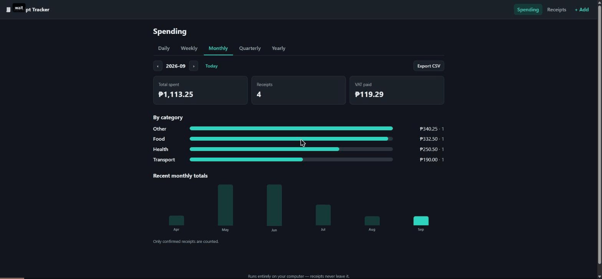

# Receipt Tracker

Snap or upload a Philippine receipt, get a clean record, and see where your money went. **The app and its AI model run on your own computer, so your receipts never leave it.**



*The real app (Docker, `qwen3-vl:8b-instruct` on an AMD GPU) with a synthetic receipt: the model reads `08/09/2026` as September 8, the date is fixed in review ("You corrected"), and it shows up in August's spending.*

> **Status:** works end to end, from photo to reviewed receipt to spending summary, and ships as Docker, a Windows exe and a demo site. Still growing the test dataset and tuning the prompt; see the [roadmap](ROADMAP.md).
>
> _Last updated: 2026-09-30_

**Stack:** ASP.NET Core (.NET 10) · EF Core + SQLite · Ollama (`qwen3-vl:8b-instruct`) · xUnit · React + TypeScript PWA (Vite) · Python for the extraction eval

## Try it

**Quickest (nothing to install):** open **https://receipt-tracker-demo.pages.dev**. It runs in your browser with made-up receipts, and the sample photos under **Add** replay the real model's answers. Uploading **your own** receipt photo there only works while my PC is online running the [live demo](docs/live-demo.md#read-on-the-authors-pc-live-demo-on-demand) (the model reads it on my PC, and nothing is kept); the rest of the time the site says so and you can use the samples.

**On your own PC (needs [Docker Desktop](https://www.docker.com/products/docker-desktop/)):** how long it takes depends on how far you go:

| | Takes about | You get |
|---|---|---|
| **1. The app with sample data** (below) | ~5 minutes once Docker Desktop is installed (~1 GB download) | Every screen, 47 sample receipts to review and chart. Your own photos can't be read yet |
| **2. Reading your own receipts** ([below](#reading-your-own-receipts)) | Another 6 GB model download (~10 min at 100 Mbps), plus installing Ollama if you use it outside Docker | Uploads read in ~10–20s each on a good GPU, **minutes each on a CPU** |

If Docker Desktop isn't installed yet, add its install (on Windows it may also set up WSL 2 and ask you to restart).

**Step-by-step guides** (installing Docker, troubleshooting, checking the GPU is used): [Windows](docs/install/windows.md) · [Linux](docs/install/linux.md) · [NVIDIA GPU](docs/install/nvidia-gpu.md) · [AMD GPU](docs/install/amd-gpu.md). The quick version is below.

Run these in a terminal. **`docker compose` must be run from the project's root folder** (the `ReceiptExtractor` folder that contains `docker-compose.yml`), not from a subfolder like `web` or `src`:

```bash
git clone https://github.com/WMGamponia/ReceiptExtractor.git
cd ReceiptExtractor          # the project root: docker-compose.yml is here
docker compose up --build
```

If you see `no configuration file provided: not found`, you're in the wrong folder: `cd` into `ReceiptExtractor` and try again. All the `docker compose` commands below are run from the same folder.

Then open **http://localhost:5080**. The first build takes a few minutes. What you'll see:

- **Receipts:** 7 real receipts (TINs redacted) waiting for review. Open one to see the photo next to the extracted fields and the VAT check, then confirm it.
- **Spending:** 40 made-up receipts from the past year, with totals by category, a chart, and **Export CSV**.
- **Add:** uploading **your own photo won't work yet.** It fails with "Can't reach Ollama" because this command starts the app without the AI model. To have uploads read, see [Reading your own receipts](#reading-your-own-receipts) below.

Stop it with `docker compose down`, or `docker compose down -v` to also delete the data.

### Reading your own receipts

The app sends each photo to a vision model running on your PC through [Ollama](https://ollama.com). This is the slow part of the setup: the model is a 6 GB download, and without a supported GPU each receipt takes minutes (see [Limitations](#limitations)). If you just want to see the model at work, the [demo site](https://receipt-tracker-demo.pages.dev)'s sample photos replay its real answers. Pick one:

| Your PC | Do this | Speed per receipt |
|---|---|---|
| **Has a GPU** (NVIDIA, AMD Radeon, or an Apple Silicon Mac): recommended | 1. Install [Ollama](https://ollama.com/download) on your PC (not in Docker).<br>2. `ollama pull qwen3-vl:8b-instruct` (6 GB, once).<br>3. `OLLAMA_URL=http://host.docker.internal:11434 docker compose up --build`<br>(PowerShell: `$env:OLLAMA_URL="http://host.docker.internal:11434"; docker compose up --build`) | ~10–20s (9s median on an AMD RX 9070 XT) |
| **Has no GPU** (or you don't want to install anything besides Docker) | `docker compose --profile ai up --build`. It also runs Ollama in Docker and downloads the 6 GB model once (`docker compose logs -f ollama-pull` shows progress) | **Minutes**: it runs on the CPU |

**Why Ollama on the PC for a GPU:** Docker Desktop on Windows and macOS can't give containers an AMD or Apple GPU, so Ollama in Docker would fall back to the CPU. Ollama installed on the PC uses the GPU directly. For AMD it uses ROCm: install a current AMD Adrenalin driver, and check that your card is on [Ollama's supported GPU list](https://docs.ollama.com/gpu) (Radeon RX 7000 and 9000 series; my RX 9070 XT works on Windows even though the list only shows it for Linux). Ollama may also use other GPUs through Vulkan, but I haven't tried that. To confirm the GPU is being used, run `ollama ps` while a receipt is being read: it should say `100% GPU`. Details for each card and system: [NVIDIA GPU](docs/install/nvidia-gpu.md), [AMD GPU](docs/install/amd-gpu.md) (Linux users can also run Ollama in Docker on the GPU; both guides explain how).

Receipts uploaded before the model is ready can be retried with **Try again**.

### What you need

| Software | Needed for | Required? |
|---|---|---|
| [Docker Desktop](https://www.docker.com/products/docker-desktop/) (Windows needs WSL 2, which Docker's installer sets up) | Running the app | **Yes** (or the .NET/Node tools below) |
| A modern browser (Chrome, Edge, Firefox, Safari) | Using the app | **Yes** |
| [Ollama](https://ollama.com) + the `qwen3-vl:8b-instruct` model | Reading uploaded receipts | Only to read your own photos (can also run inside Docker with `--profile ai`) |
| Git | Cloning the repo | Or download the ZIP from GitHub |
| [.NET 10 SDK](https://dotnet.microsoft.com/download) + [Node.js 20+](https://nodejs.org) | Running without Docker, or building the Windows exe | Only for development |
| Python 3.12 (+ optionally Tesseract) | The extraction eval | Only to re-run the bake-off |

### Limitations

- **The AI model needs a capable GPU.** Receipts take ~10–20s each on a desktop GPU (tested on an AMD RX 9070 XT) and **minutes on a CPU**: even the smaller `qwen3-vl:2b-instruct` took 99s per receipt in Docker on a 24-thread CPU (and missed the date). The GPU has to be one Ollama supports (recent NVIDIA, AMD or Apple Silicon). Running the model on a cloud service would drop this requirement, but receipt photos would leave your machine; it's an idea for later, not built.
- **Docker Desktop on Windows can't use an AMD GPU.** On an AMD Windows PC, install Ollama itself and use the `OLLAMA_URL` command above. The NVIDIA/AMD GPU files for the Ollama container (`docker-compose.nvidia.yml`, `docker-compose.amd.yml`) haven't been tested.
- **Memory and disk:** about 1 GB for the app image, plus 6 GB for the model and ~8 GB of RAM to run it in Docker.
- **Port 5080** must be free (and 11434 if Ollama runs on your PC).
- **Built for Philippine receipts:** peso amounts, 12% VAT included in the total, BIR-style receipts. Other countries' receipts will be read, but the VAT check won't make sense for them.
- **JPG and PNG photos only** (no PDFs or HEIC).
- **The model makes mistakes:** 86% of dates, merchants and totals are right on the 7 labeled receipts (a small sample; see [Known issues](#known-issues)). That's why every receipt goes through a review screen, and suspicious ones are flagged.
- **One user, no logins.** Anyone who can reach port 5080 sees every receipt, so don't expose it to the internet.
- **Sample data is Docker only.** `dotnet run` and the Windows exe start with an empty database.
- **The Windows exe is unsigned,** so SmartScreen warns the first time (**More info → Run anyway**).
- **Installing it as a phone app needs HTTPS**, which the local app doesn't have. Opening it in the phone's browser on the same Wi-Fi works.

## What this project shows

- **The approach was chosen by testing, not guessing.** Before building the app, I hand-labeled real receipts and compared OCR + LLM against a vision model on them: 19% vs 86% core accuracy ([bake-off](#extraction-bake-off)).
- **CI blocks merging if accuracy drops under 85%.** The model's outputs are committed, so CI scores them without a GPU, and it fails if the prompt, model or dataset changes without a re-run.
- **Privacy by design.** Everything runs locally; OCR text (with TINs) never goes into git; the public live demo registers no database or storage and keeps nothing.
- **Built for how models fail.** Extraction runs in a background queue with live status; a VAT checksum and date checks send suspicious receipts to review; corrections can be locked and the rest re-read.
- **One rule, three languages, one set of tests.** The VAT check exists in C#, TypeScript and Python, and all three run against the same cases in `tests/vat-cases.json`.
- **Shipped three ways:** `docker compose up` with sample data, a single-file Windows exe, and a static demo site that replays real model answers.

## What it does

- **Add:** take a photo (opens the back camera on a phone) or drop/pick files. The model reads each one in the background.
- **Receipts:** everything waiting for review, with status updating live while the model reads. Tick receipts (or **Select all ready to confirm**) and confirm them in one go; anything that failed a check is called out before you confirm.
- **Review:** the photo next to the extracted fields. VAT math is re-checked as you type, and future dates are flagged (the model sometimes swaps day and month). The photo can be rotated, zoomed and dragged; **←.** / **.→** move a misplaced decimal point (`112446.00` → `1,124.46`); **Work out VAT from the total** fills in missing VAT lines; **Re-extract** keeps your corrections and has the model re-read the rest.
- **Spending:** totals for any day, ISO week, month, calendar quarter or year, broken down by category (confirmed receipts only). **Export CSV** downloads the period's receipts with plain-number amounts a spreadsheet can add up.

It extracts these fields:

| Field | Example |
|---|---|
| Merchant | DataBlitz |
| Date | 2025-12-20 |
| Total | ₱10,495.00 |
| VAT amount | ₱1,124.46 |
| VATable sales | ₱9,370.54 |
| VAT-exempt sales | ₱500.00 (e.g. senior citizen / PWD purchases) |
| Discount | ₱100.00 (all discounts on the receipt, added up) |
| Category | Shopping — one of Food, Groceries, Transport, Fuel, Health, Utilities, Shopping, Other (suggested by the model, you can change it) |

Full scope and non-goals: [SCOPE.md](SCOPE.md).

### A tracker, not a tax tool

This shows where your money went. It doesn't file anything with the BIR, compute your taxes or claim a receipt is valid for deductions. The VAT check only confirms that a receipt's own numbers add up (VATable sales + 12% VAT = total), to catch misreads.

## How it works

**Why local-first:** receipts are personal data: names, addresses, TINs, what you bought and where. The app and the AI model both run on your own computer, so nothing gets sent to a cloud API. That also means no per-receipt API bill, but privacy is the main reason, not cost. The trade-off is the GPU requirement (see [Limitations](#limitations)).

**How a receipt flows:** upload → saved to disk + DB row `Queued` → background worker sends the image to Ollama with a JSON schema → model output parsed and cleaned (e.g. "LAZADA Edifier" → "LAZADA") → checks run (VAT breakdown: VATable + VAT + VAT-exempt = total, or = total + discount for senior citizen / PWD discounts; VAT = 12% of VATable sales; date; total) → `Extracted`, or `NeedsReview` with reasons → user confirms/corrects → `Confirmed`. If a correction should change other fields too (e.g. the right VAT line), **Re-extract** keeps the corrected fields, tells the model they're correct, and re-reads the rest. The model's raw output is kept, so user corrections can later become new eval data.

## Extraction bake-off

Before building anything, I compared two ways to pull these fields out of real receipt photos (faded thermal paper, rotated Lazada waybills, BIR-format invoices):

- **OCR + LLM:** Tesseract reads the text, then a local LLM turns that text into fields.
- **Vision model:** a local vision-language model looks at the photo and returns the fields directly.

Both use the same model (`qwen3-vl:8b-instruct` via [Ollama](https://ollama.com)), prompt and JSON schema, so the only difference is *seeing the image* vs *reading OCR text*.

**Results on hand-labeled receipts** (7 in the original bake-off, 8 now) (AMD Radeon RX 9070 XT):

| Approach | Merchant | Date | Total | VAT | Core accuracy¹ | Median | Slowest |
|---|---|---|---|---|---|---|---|
| **Vision model** | 75% | 88% | 100% | 100% | **88%** ✅ | 8.9s | 17.3s |
| Tesseract + LLM | 29% | 0% | 29% | 43% | 19% ❌ | 1.5s | 2.0s |

¹ Date + merchant + total. Target: ≥ 85%, under 30s per receipt. Full breakdown: [eval/RESULTS.md](eval/RESULTS.md).
The vision row is the latest run (2026-09-30, 8 receipts, the current prompt: VAT-exempt sales, discount, tax tables, "Less VAT" lines and keeping the decimal point; the original bake-off scored 95%). The Tesseract row is from the original bake-off. CI re-scores the vision row on every PR (see [Continuous integration](#continuous-integration)).

PaddleOCR + LLM was also tried by hand on one receipt: 4/5 fields after tuning, but ~85s per receipt, because PaddleOCR can't use an AMD GPU on Windows.

### What I learned

- **Plain OCR breaks on real-world receipts.** Tesseract returned almost nothing on 3 of 7 receipts (rotated, faded, low contrast), and it can't read stylized logos, so the store name often never reaches the LLM.
- **One misread digit ruins a field.** `15,190` became `73,190`; `Dec 21 2025` became `Dec 24 7025`.
- **Two kinds of error need two kinds of fix.** *Reading* errors (bad OCR) need a better OCR engine or a better photo. *Understanding* errors (e.g. picking the BIR "Date of ATP" printer-permit date instead of the transaction date) are fixed in the prompt.
- **PH receipts have a built-in checksum.** VAT is included in the total, so `vatable sales + VAT = total` and `VAT = total × 12/112`. Checking that flagged every bad Tesseract result and none of the vision results, so the app uses it to send suspicious receipts to review.
- **Check what the model actually sees.** A phone photo read VAT as `10714` instead of `107.14`, but the same photo sent through Discord read fine. Phones save photos sideways with an EXIF tag saying how to turn them; browsers obey it, Ollama doesn't, so the model was reading the receipt on its side. The app now turns photos upright before sending them (`Extraction/PhotoOrientation.cs`, and the same in the eval), and that receipt is in the dataset. Resizing turned out not to matter: the eval scored the same at 1536, 2048 and 4080 px.
- **Prompts are suggestions; code is a rule.** Asking for "centavos exactly as printed" fixed dropped decimals, but the model still ignored a rule about marketplace names. Exact rules belong in code after extraction.

### Known issues

- **Accuracy is one miss above the target.** Core accuracy is 88% against the 85% target, so the next prompt change that costs a field will fail CI. Teaching the model VAT-exempt sales and discounts cost some accuracy: the original bake-off scored 95%.
- **Where it's wrong:** two merchant names (one misread, one with an extra word: "LAZADA Edifier"), one date with day and month swapped, and the VAT split on two receipts (the whole total put under VAT-exempt or VATable sales). The VAT check flags one of those. Each miss is listed in [eval/RESULTS.md](eval/RESULTS.md).
- **Decimal points in small VAT tables.** On a receipt with a Net / VAT / Gross table (not in the dataset yet), the model read `125.13` as `125` or `12513` depending on the image size. A prompt line ("Keep the decimal point") fixed it at every size, but a new layout could bring it back; the VAT check flags it when it does.
- **Small sample.** Eight receipts, none with a real discount yet. The dataset is growing toward 30–50, including handwritten sari-sari receipts.

## For developers

### Run it as a desktop app (Windows)

Build once:

```bat
publish.cmd
```

That creates **`publish\ReceiptTracker.exe`**, a single file containing the API *and* the web app (no .NET or Node needed to run it). Start Ollama, double-click the exe, and your browser opens at http://localhost:5080. Close the console window to stop it.

- Your database and receipt images are saved in a `data` folder next to the exe, so the whole folder is portable.
- To change settings (model, Ollama address, port) without rebuilding, put a `settings.json` next to the exe, e.g. `{ "Ollama": { "Model": "qwen3-vl:4b-instruct" } }`.
- To use it from your phone on the same Wi-Fi: `ReceiptTracker.exe --urls http://0.0.0.0:5080`, then open `http://<your-PC's-IP>:5080`. This makes it reachable by anyone on your network, since there are no logins.

### Run with Docker

The basics are in [Try it](#try-it). More options:

- **What's in it:** the API + web app in one image, with the SQLite database and images in the `app-data` volume. On first start, an empty database is filled with the sample receipts; delete them from the Receipts page whenever you like, and a database that has receipts is never seeded again (`Seed:Enabled`).
- **GPU for the Ollama container:** add `-f docker-compose.yml -f docker-compose.nvidia.yml` (NVIDIA) or `-f docker-compose.amd.yml` (AMD, Linux only).
- **A different model:** `MODEL=qwen3-vl:4b-instruct docker compose --profile ai up`. Smaller models are faster but less accurate (only the 8B was scored in the bake-off).
- `docker compose down -v` also deletes the downloaded model.

### Downloading the model (without Docker)

`scripts\pull-model.ps1` (Windows) or `scripts/pull-model.sh` (Linux/macOS) downloads the model the app is set to use into your local Ollama, and does nothing if it's already there:

```bash
powershell -ExecutionPolicy Bypass -File scripts\pull-model.ps1        # model from appsettings.json
powershell -ExecutionPolicy Bypass -File scripts\pull-model.ps1 -Model qwen3-vl:4b-instruct
```

### Running the API

Requirements: [.NET 10 SDK](https://dotnet.microsoft.com/download) and Ollama running with `qwen3-vl:8b-instruct` pulled.

Open `ReceiptExtractor.sln` in Visual Studio and run the **http** profile, or:

```bash
dotnet run --project src/ReceiptExtractor.Api     # http://localhost:5036
dotnet test                                       # unit tests
```

| Endpoint | What it does |
|---|---|
| `POST /api/receipts` | Upload a JPG/PNG (form field `file`). Returns **202** right away; extraction runs in the background |
| `GET /api/receipts/{id}` | Status (`Queued` → `Processing` → `Extracted` / `NeedsReview` / `Failed`), fields and review flags |
| `GET /api/receipts` | All receipts, newest first |
| `GET /api/receipts/export.csv?from=&to=` | Confirmed receipts as a CSV file, oldest first. Both dates optional; `to` is the day *after* the last one (like the summary's `end`) |
| `GET /api/receipts/{id}/image` | The receipt image |
| `PUT /api/receipts/{id}/image` | Replace the image (e.g. rotated). Fields are kept, extraction is **not** re-run; the first version is backed up as `{id}.original.jpg` |
| `PUT /api/receipts/{id}` | Save reviewed/corrected fields → `Confirmed` |
| `POST /api/receipts/confirm` | Bulk confirm `{ "ids": [...] }` with the extracted fields as-is. Receipts still being read, failed, or missing date/total/category are skipped with a reason |
| `POST /api/receipts/{id}/retry` | Re-run a failed extraction |
| `POST /api/receipts/{id}/reextract` | Re-extract with corrections: `{ "fields": {...}, "locked": ["total", "vat_amount"] }`. Locked fields are kept and given to the model as known-correct; it re-reads the rest |
| `DELETE /api/receipts/{id}` | Delete the receipt and its image files (incl. the `.original` backup). **409** while the model is reading it |
| `POST /api/receipts/delete` | Bulk delete `{ "ids": [...] }` (records + image files). Receipts the model is reading are skipped with a reason |

`src/ReceiptExtractor.Api/ReceiptExtractor.Api.http` has ready-made requests you can click in Visual Studio. The database (`receipts.db`) and uploaded images (`storage/`) are created on first run; columns added later are patched into an existing database on startup (`Data/SchemaPatches.cs`).

### Running the web app

Requirements: Node.js 20+, and the API running (above).

```bash
cd web
npm install
npm run dev          # http://localhost:5173 — /api calls are proxied to the API
npm test             # unit tests (formatting, VAT warnings)
```

**On your phone:** with both running, open `http://<your-PC's-IP>:5173` on the same Wi-Fi. "Take photo" opens the camera.

### Running the evaluation

Requirements: Windows/macOS/Linux, Python 3.12, [Ollama](https://ollama.com), and optionally [Tesseract](https://github.com/UB-Mannheim/tesseract/wiki) (Windows: `winget install -e --id UB-Mannheim.TesseractOCR`).

```bash
python -m venv .venv
.venv\Scripts\activate            # macOS/Linux: source .venv/bin/activate
pip install -r requirements.txt
ollama pull qwen3-vl:8b-instruct

# one receipt, one approach
python eval/try_vision.py datasets/labels/20251220_DataBlitz.jpg

# one receipt, all approaches side by side (with raw OCR text)
python eval/compare_approaches.py datasets/labels/20251220_DataBlitz.jpg

# every labeled receipt, scored -> eval/RESULTS.md
python eval/run_eval.py --only vision tesseract
```

Predictions are cached in `eval/preds/` and re-run automatically when the model or prompt changes (`--fresh` forces a re-run).
`eval/preds/` holds OCR text, so it's never committed; each run also saves the extracted fields and timing (no OCR text) to `eval/model_outputs/`, which **is** committed so CI can score the eval without a GPU. **After changing the prompt, re-run the eval and commit `eval/model_outputs/`**, or CI fails.

```bash
python eval/run_eval.py --offline --only vision --check   # score the committed outputs, like CI
python -m unittest discover -s eval -p "test_*.py"        # scoring rules
```

### Continuous integration

`.github/workflows/ci.yml` runs on every pull request and on `main`, with four jobs:

| Job | What it checks |
|---|---|
| API tests | `dotnet test` (parsing, VAT math, periods, CSV, seed data, and that the app's prompt matches the eval's) |
| Web app | `npm run lint`, `npm test`, `npm run build`, `npm run build:demo` |
| Extraction eval | Scores the committed `eval/model_outputs/` (no GPU, no Ollama). **Fails** if core accuracy drops under 85%, or if the prompt, model or dataset changed without re-running the eval. The results table is on the run's summary page |
| Docker | `docker build` |

The VAT check lives in three places (API, web app, eval), so all three are tested against the same cases in `tests/vat-cases.json`.

### Demo site and live demo

How the demo site is built and deployed to Cloudflare Pages, how its sample receipts are made, and how the on-demand live demo works (Tailscale Funnel, limits, setup): [docs/live-demo.md](docs/live-demo.md).

### Project structure

```
ReceiptExtractor.sln
publish.cmd      builds publish\ReceiptTracker.exe (API + web app in one file)
Dockerfile       the same app as a Linux image (web app built in)
docker-compose.yml         app (+ Ollama and a model download with --profile ai)
docker-compose.nvidia.yml  / docker-compose.amd.yml: GPU for the Ollama container
scripts/         pull-model.ps1 / pull-model.sh: download the vision model into Ollama
                 live-demo.ps1: let demo-site visitors' photos be read on this PC for a few hours
                 LiveDemoLauncher/: LiveDemo.exe, a double-click launcher for live-demo.ps1 (not in the solution)
src/ReceiptExtractor.Api/
  Endpoints/     HTTP endpoints (upload, status, confirm, retry, delete)
  Extraction/    Ollama client (turns sideways photos upright first), background queue + worker
  Validation/    VAT math, date checks, merchant clean-up
  Data/          EF Core entity + DbContext (SQLite)
  Summaries/     period math (ISO weeks, calendar quarters) + GET /api/summary
  Hosting/       desktop mode: data folder next to the exe, opens the browser, checks Ollama
  Seeding/       demo data for an empty database (Docker): labeled receipts + made-up ones
  Export/        CSV export (Excel-friendly: UTF-8 BOM, formula-safe text)
  LiveDemo/      live demo mode: extract-only, no database or storage, limits (scripts/live-demo.ps1)
tests/ReceiptExtractor.Tests/   xUnit tests
tests/vat-cases.json            VAT check cases shared by the C#, TypeScript and Python tests
.github/workflows/ci.yml        CI: tests, eval from cached model outputs, Docker build
web/
  src/pages/     Dashboard, Receipts, Review, Upload
  src/api.ts     typed API client
  src/format.ts  peso/date formatting, VAT warnings (mirrors ReceiptValidator.cs)
  src/demo/      demo site (npm run build:demo): in-browser stand-in for the API, made-up data
  public/demo/   synthetic receipt images for the demo site
datasets/
  labels/        receipt images
  receipts/      hand-labeled ground truth (one JSON per image)
docs/            demo GIF, live-demo.md (demo site + live demo), design specs
  install/       step-by-step install guides: Windows, Linux, NVIDIA GPU, AMD GPU
eval/
  try_vision.py            one receipt through the vision model
  compare_approaches.py    vision vs Tesseract vs PaddleOCR on one receipt
  run_eval.py              score every approach on every receipt (--offline: from model_outputs/, for CI)
  test_scoring.py          tests for the scoring rules
  test_upright.py          tests for turning sideways photos upright (needs Pillow)
  model_outputs/           extracted fields per receipt (committed; no OCR text)
  make_demo_receipts.py    synthetic receipts for the demo site, read by the real app
  merchant_aliases.json    store name ↔ company name equivalents
  RESULTS.md               latest scores
SCOPE.md         what the MVP does and doesn't do
ROADMAP.md       steps to finish
```

### Privacy note

`eval/preds/` holds the full OCR text of each receipt (including TINs), so it's in `.gitignore`. `eval/model_outputs/` only has the extracted fields (merchant, date, amounts), the same values as the committed labels and `RESULTS.md`. Receipt images must have TINs and card digits redacted before they're committed.
